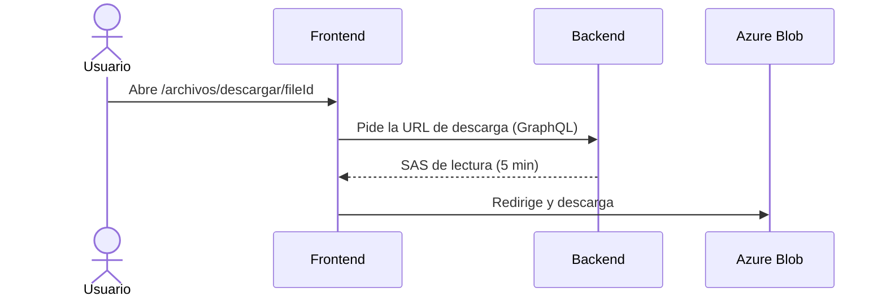
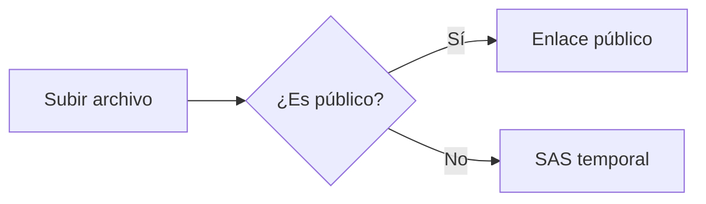

# Guía de instalación del Asistente Técnico

Este documento explica cómo instalar el **Asistente Técnico** en un servidor con *Windows Server 2022*. Tarda ~15 minutos.

> [!IMPORTANT]
> Haz un respaldo de la base de datos antes de empezar 🚀.

## Requisitos

1. Docker Desktop 4.30 o superior
2. SQL Server 2019 → configurado en modo mixto
3. Acceso a [GitHub](https://github.com) y al README del proyecto

- [x] Descargar el instalador
- [ ] Configurar el archivo `appsettings.json`

| Componente | Versión | ¿Obligatorio? |
|---|---|---|
| .NET | 10 | ✅ |
| Docker | 4.30 | ❌ |

---

## Ejecución

Corre el siguiente comando en PowerShell:

```powershell
docker compose up -d
```

Si algo falla, revisa los registros (p. ej. `docker logs api`) & reporta en <https://soporte.ejemplo.com>.

## Cómo fluye una descarga




